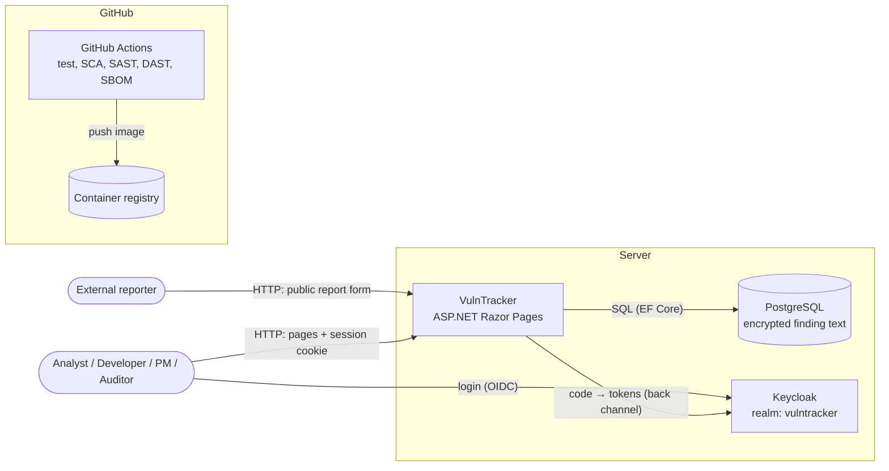

# Design (W39 – initial plan)

## Tech stack

| Part | Choice | Why |
|---|---|---|
| Web app | ASP.NET Core 10 Razor Pages (server-rendered) | Teacher's OIDC examples are ASP.NET. No SPA means no tokens in the browser. |
| Database | PostgreSQL 18 with Entity Framework Core | Relational data. EF Core parameterizes queries. |
| Identity provider | Keycloak 26 (OIDC) | Recommended in W41. Users, passwords and roles live there, not in the app. |
| Containers | Docker, Docker Compose for local development | Needed for the image push (W40) and SBOM (W45). |
| CI/CD | GitHub Actions, image pushed to GitHub Container Registry | Tests, security gates, SBOM. |
| Tests | xUnit, `WebApplicationFactory` | Policies tested directly and through HTTP. |

## High-level architecture

Request flow for staff:

1. The browser opens the app. With no session cookie, it is redirected to Keycloak.
2. The user logs in at Keycloak.
3. Keycloak redirects back with an authorization code.
4. The app exchanges the code (plus client secret and PKCE verifier) for tokens. It reads the user id and roles, then sets an encrypted session cookie.
5. Each page checks the role policy and, for a single finding, the per-finding rule.

Code layout:

| Path | Contents |
|---|---|
| `src/VulnTracker/Authorization/` | Roles, policies, per-finding rules |
| `src/VulnTracker/Data/` | Entities, `AppDbContext`, migrations |
| `src/VulnTracker/Security/` | Field encryption |
| `src/VulnTracker/Pages/` | Razor Pages |
| `tests/VulnTracker.Tests/` | Unit and integration tests |

## User stories

**External reporter**
- As an external reporter, I want to report a vulnerability without creating an account, so that it's easy to tell the company. *(AUTH-03, FIND-02)*
- As an external reporter, I want confirmation that my report arrived, so that I know it wasn't lost. *(AUTH-03)*

**Analyst**
- As an analyst, I want to log in with my company account, so that I don't need another password. *(AUTH-01)*
- As an analyst, I want to register a finding I discovered, so that it gets tracked. *(FIND-01)*
- As an analyst, I want to triage a finding (set severity and status), so that the most dangerous ones get fixed first.
- As an analyst, I want to assign a finding to a developer with a due date, so that someone is responsible for fixing it in time. *(FIND-04)*
- As an analyst, I want to filter findings by status, severity, owner and asset, so that I can find what needs attention. *(FIND-05)*

**Developer**
- As a developer, I want to see only the findings assigned to me, so that I know what to fix. *(FIND-05, ReBAC)*
- As a developer, I want to update the status and details of my findings, so that others see the progress.

**PM**
- As a PM, I want everything an analyst can do, so that I can step in during triage.
- As a PM, I want to accept a risk when fixing isn't worth it, so that the decision is recorded. *(Accepted Risk)*

**Auditor**
- As an auditor, I want read-only access to all findings and the dashboard, so that I can check CRA compliance without being able to change anything.

**Everyone with a role**
- As a user, I want a dashboard of open findings by severity and status, so that I see the overall situation at a glance. *(FR-RPT-01)*
