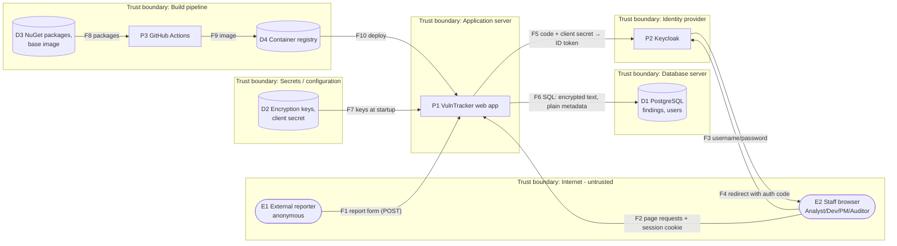
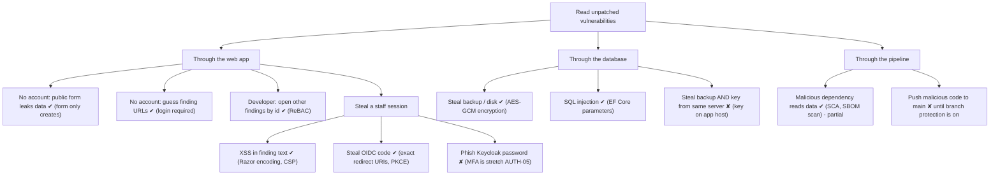

# Threat model (W39)

Techniques from the lecture: a **data flow diagram (DFD)**, **STRIDE** per element and an **attack tree**.
They answer the three questions.

## 1. What are we working on?

See [design.md](design.md) for the stack and architecture. The asset worth protecting is the **list of unpatched
vulnerabilities**. For an attacker it's a shopping list. The reporter email addresses are also personal data (GDPR).

### Data flow diagram

Dashed boxes are **trust boundaries**: data crossing one comes from something less trusted.

## 2. What can go wrong? (STRIDE)

| # | Element | STRIDE | Threat |
|---|---|---|---|
| T1 | F1 report form | **S**poofing | Reporter claims someone else's email address. |
| T2 | F1 report form | **T**ampering | Extra form fields set status, assignee or source (mass assignment). |
| T3 | F1 report form | **D**enial of service | Form is flooded with fake reports. |
| T4 | F1 report form | **I**nformation disclosure | Form response or error page leaks other findings. |
| T5 | F2 page requests | **S**poofing | Session cookie stolen or forged. |
| T6 | F2 page requests | **E**levation of privilege | Developer opens or edits findings not assigned to them (IDOR). |
| T7 | F2 page requests | **E**levation of privilege | Developer sets *Accepted Risk*. Auditor edits. User without a role sees data. |
| T8 | F2 page requests | **T**ampering | CSRF: another site submits a form with the analyst's cookie. |
| T9 | F2 page requests | **T**ampering | Clickjacking: app framed on a malicious site. |
| T10 | F2 page requests | **I**nformation disclosure | XSS through finding text, stealing data shown to other users. |
| T11 | F3/F4/F5 login | **S**poofing | Authorization code stolen via a malicious redirect URI, or replayed. |
| T12 | P1 web app | **R**epudiation | A user changes or closes a finding and denies it. |
| T13 | P1 web app | **I**nformation disclosure | Stack traces or configuration shown in error pages. |
| T14 | D1 database | **I**nformation disclosure | Database or backup stolen. All vulnerabilities readable. |
| T15 | D1 database | **T**ampering | Insider edits finding text directly in the database. |
| T16 | F6 SQL | **T**ampering | SQL injection through filter or form fields. |
| T17 | D2 keys | **I**nformation disclosure | Encryption key leaks (git, logs, database). |
| T18 | D3 dependencies | **T**ampering | Vulnerable or malicious package or base image (supply chain). |
| T19 | P3/D4 pipeline | **T**ampering | Unreviewed code pushed straight to `main` and deployed. |
| T20 | P2 Keycloak | **D**enial of service | Keycloak down, so nobody can log in. |

### Attack tree

Goal: **read the list of unpatched vulnerabilities.** Leaves marked ✔ are mitigated.

## 3. What are we going to do about it?

| # | Mitigation | Status |
|---|---|---|
| T1 | The email is only contact info and is never trusted for access. Triage verifies the report. | Accepted |
| T2 | Forms bind to input models with only allowed fields. | ✅ Implemented, tested |
| T3 | Rate limiting / CAPTCHA on the public form. | ❌ Not implemented. Accepted risk for the exam scope; the first thing to add before going live. |
| T4 | Acknowledgement shows no finding data. Production has no developer error page. | ✅ Implemented, tested |
| T5 | Session cookie is HttpOnly and encrypted by ASP.NET Data Protection. Production must use HTTPS. | ✅ (HTTPS is a deployment requirement) |
| T6 | ReBAC rule on details/edit pages and on list/dashboard queries. | ✅ Implemented, tested |
| T7 | Role policies plus ABAC rule for *Accepted Risk*. Fallback policy requires login. Users without a role get nothing. | ✅ Implemented, tested |
| T8 | Antiforgery tokens on every POST. Logout is POST-only. | ✅ Implemented |
| T9 | CSP `frame-ancestors 'none'`. | ✅ Implemented, checked by ZAP |
| T10 | Razor HTML-encodes output. CSP `default-src 'self'` blocks injected scripts. | ✅ Implemented, checked by ZAP |
| T11 | Authorization code flow with PKCE, client secret, exact redirect URIs in Keycloak. | ✅ Implemented |
| T12 | Audit log (AUDIT-01). | ❌ Not implemented (SHOULD, outside solo scope). Known gap. |
| T13 | No developer exception page outside Development. | ✅ ASP.NET default |
| T14 | AES-256-GCM encryption of title, description, reporter email. | ✅ Implemented, tested. See [cryptography.md](cryptography.md) |
| T15 | GCM authentication tag. The column name is bound to the ciphertext. | ✅ Implemented, tested. Moving whole rows is not detected. |
| T16 | EF Core parameterized queries. No raw SQL in the app. SAST (Semgrep) in CI. | ✅ Implemented |
| T17 | Keys from environment variables / secret store in production, never the database. Dev key only in dev config. | ✅ Documented in [cryptography.md](cryptography.md) |
| T18 | SCA (`dotnet list package --vulnerable`), SBOM (Syft) and Grype scan of the image before it's pushed. | ✅ In CI |
| T19 | Branch protection on `main` with required status checks and PR reviews. | ⚠️ GitHub setting the repo owner must turn on (see README) |
| T20 | Out of scope for this project (run Keycloak highly available in production). | Accepted |

### Limits of this threat model

- DAST (ZAP) only scans pages that don't need login. Logged-in pages are covered by the integration tests instead.
- The encryption key sits on the same host as the app. Someone who fully takes over the app server can read
  everything. Encryption protects against a stolen database or backup, not a hacked app server.
